  

  
  
  

### 👾 About me

- 🎓 Computer Science student at **Dalhousie University** (Halifax, NS)
- 🏆 **BUhack 2026 Grand Champion**: 1st of 80+ competitors with a Chrome extension built in 48 hours
- 🧪 I build full-stack web apps and Android apps in Agile teams, and I write the tests before the feature
- 🎯 Looking for a **4–8 month co-op starting Winter 2027**: software development, mobile, back end or test automation
- 🎮 Gamer, which is why [my portfolio](https://daanyaalsportfolio.vercel.app) boots like one

### 🕹️ Featured missions

| | Project | What it is | Built with |
|:-:|---|---|---|
| 🥇 | **[FlowState](https://github.com/Daanyaal5/FlowState)** | Digital-wellness Chrome extension: tab monitoring, late-night nudges, usage charts. **BUhack 2026 Grand Champion.** | JavaScript · Manifest V3 · Chart.js |
| 🗂️ | **[JobTrack](https://github.com/Daanyaal5/JobTrack)** · [▶ live demo](https://daanyaal-jobtrack.vercel.app) | Kanban job-application tracker with reminders and funnel stats. CS50x final project. | Python · Flask · PostgreSQL · Vercel |
| 📱 | **[Job Match](https://github.com/Daanyaal5/Matching-Recruitment-Android-Application-3130_project-)** | Two-sided Android recruitment app with real-time posts and map search, built test-first. | Java · Firebase · JUnit · Espresso |
| 🌈 | **[Community Platform](https://github.com/Daanyaal5/pride-stem-networking-2691-project-Minimum_Viable_Product-)** | Full-stack social platform MVP built from client requirements. | React · Node.js · MySQL |
| 🌇 | **[Portfolio](https://github.com/Daanyaal5/portfolio-react)** · [▶ live](https://daanyaalsportfolio.vercel.app) | Game-style portfolio with a loading screen, weapon-wheel skills and mission cards. | React · CSS |

### 🧰 Loadout

  
  
  
  
  
  
  
   
  
  
  
  
  
  
  
   
  
  
  
  
  
  

### 📊 Stats

  
  

  

  <picture>
    <source media="(prefers-color-scheme: dark)" srcset="https://raw.githubusercontent.com/Daanyaal5/Daanyaal5/output/snake-dark.svg">
    
  </picture>

Charts are generated by a GitHub Action in this repo and refresh daily.

